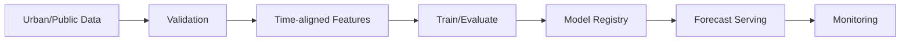

# pivotSeoul 

## 1. 핵심 한 줄

> **pivotSeoul은 시뮬레이션 결과 조회의 N+1 가능성을 JOIN 1회로 고정하고, 인덱스·Partial Index·BRIN·파티셔닝·Star Schema·Materialized View·증분 ETL까지 적용해 MVP 실행 경로와 데이터 파이프라인을 함께 최적화한 프로젝트입니다.**

---

## 2. 효율화 배경

pivotSeoul은 사용자 조건을 기반으로 주거비 부담 시뮬레이션을 실행하고, 결과와 임계값 판단을 제공하는 프로젝트입니다.

시뮬레이션 결과 API는 `scenario_result`와 `threshold_result`를 함께 보여줘야 합니다. 이때 JPA lazy loading 구조로 결과를 조회하면, 결과 1건을 가져온 뒤 임계값 결과 개수만큼 추가 SQL이 발생할 수 있습니다. 이를 N+1 문제라고 볼 수 있습니다.

또한 MVP 범위에서는 실제로 사용하지 않는 테이블과 컬럼이 남아 있으면, 개발자가 봐야 하는 DB 범위가 커지고, Entity/DTO/API/테스트까지 함께 복잡해집니다. 그래서 pivotSeoul은 코드 조회 경로와 DB 스키마를 모두 MVP 실행 흐름 중심으로 줄였습니다.

```text id="dhstg4"
1. 결과 조회 N+1 가능성 제거
2. readOnly 트랜잭션 적용
3. open-in-view 비활성화
4. Micrometer 기반 쿼리 시간 측정
5. 미사용 테이블 / wide 컬럼 제거
6. 실제 조회 경로에 맞춘 인덱스 추가
7. Partial Index / BRIN / 파티셔닝 적용
8. Star Schema / Materialized View / 증분 ETL 구성
```

비전공자식으로 말하면,
기존에는 결과표를 보여줄 때 **기본 결과를 가져온 뒤 임계값 판단표를 하나씩 다시 찾아올 수 있는 구조**였다면, 개선 후에는 **결과와 임계값 판단을 한 번에 묶어서 가져오는 구조**로 바꾼 것입니다.
DB도 “모든 가능성을 다 담은 큰 창고”가 아니라, **MVP에서 실제로 쓰는 방과 통로만 남기고, 분석용 창고는 따로 정리한 구조**입니다.

---

# Part 1. 코드 효율화

## 3. 코드 효율화 요약

| 항목             | 내용                                                       | 주요 파일                                               |
| -------------- | -------------------------------------------------------- | --------------------------------------------------- |
| N+1 제거         | `scenario_result` + `threshold_result` JOIN 1회           | `ScenarioResultQueryRepository.java`                |
| 결과 서비스         | JOIN repository 사용, 읽기 `@Transactional(readOnly = true)` | `SimulationResultService.java`                      |
| open-in-view 끔 | 요청 전체에 DB 세션을 붙잡지 않음                                     | `application.yml`                                   |
| 생성자 DI + 계층 분리 | Controller → Service → Repository                        | `domain/simulation/`                                |
| Query Method   | FK/UUID 기준 단건 조회                                         | `SimulationSessionRepository`, `ScenarioRepository` |
| 쿼리 시간 측정       | Micrometer `pivot.query.duration`, 50ms 이상 slow log      | `QueryMetricsAspect.java`                           |
| HTTP p95 측정    | 요청 타이밍 인터셉터                                              | `RequestTimingInterceptor.java`                     |
| 파이프라인 로그       | ETL 실행 시간·row count 기록                                   | `PipelineRunLogService.java`                        |
| 예외 처리          | 400/409/500 응답 정합 + 예외 로깅                                | `GlobalExceptionHandler.java`                       |
| N+1 회귀 테스트     | JOIN 쿼리 1회 고정                                            | `ScenarioResultQueryRepositoryTest.java`            |

---

## 4. 결과 조회 N+1 제거

### 기존 문제

F-003 결과 조회는 `scenario_result`와 여러 개의 `threshold_result`를 함께 보여줘야 합니다.

JPA lazy loading 구조라면 아래처럼 동작할 수 있습니다.

```text id="gmfb3a"
Before

scenario_result 1회 조회
→ threshold_result 1번 조회
→ threshold_result 2번 조회
→ threshold_result 3번 조회
→ ...
```

임계값 결과가 3개면 SQL이 4개, 5개면 SQL이 6개처럼 늘어날 수 있습니다.

비전공자식으로 말하면,
결과표 한 장을 가져온 뒤, 관련된 판단 근거를 **한 줄씩 다시 창고에 가서 찾아오는 구조**입니다.

---

### 개선 후

`ScenarioResultQueryRepository`에서 `scenario_result`와 `threshold_result`를 JOIN으로 한 번에 가져오도록 변경했습니다.

```text id="z5l4ps"
After

scenario_result + threshold_result
→ JOIN 1회로 함께 조회
→ 결과 조회 SQL 수 1개로 고정
```

### 효과

| 지표                         | Before, JPA lazy N+1 | After, JOIN 1회 | 개선           |
| -------------------------- | -------------------- | -------------- | ------------ |
| F-003 결과 API SQL 수, 임계값 3건 | 4개, 1 + 3            | 1개             | SQL 수 75% 감소 |
| F-003 결과 API SQL 수, 임계값 5건 | 6개, 1 + 5            | 1개             | SQL 수 83% 감소 |
| 이력 조회 `findBundlesByRunId` | run당 1 + N×M 가능      | run당 1 JOIN    | 쿼리 수 증가 방지   |

신규 회귀 테스트도 추가해 결과 조회가 다시 N+1 구조로 돌아가지 않도록 검증했습니다.


> F-003 결과 조회는 기존 JPA lazy loading 구조라면 `scenario_result` 1회 조회 후 임계값 개수만큼 `threshold_result` 추가 조회가 발생할 수 있었습니다. 이를 `ScenarioResultQueryRepository`의 JOIN 조회로 고정해, 임계값 3건 기준 SQL 4개를 1개로 줄였고, 임계값 5건 기준 SQL 6개를 1개로 줄였습니다. 신규 회귀 테스트를 추가해 결과 조회가 다시 N+1 구조로 돌아가지 않도록 쿼리 수를 검증했습니다.

---

## 5. 읽기 전용 트랜잭션 적용

`SimulationResultService`의 결과 조회는 데이터를 변경하지 않는 읽기 작업이므로 `@Transactional(readOnly = true)`를 적용했습니다.

Spring 공식문서에서 `@Transactional`은 클래스나 메서드에 트랜잭션 의미를 부여하는 메타데이터라고 설명합니다. 또한 `readOnly`는 트랜잭션이 사실상 읽기 전용임을 나타내며, 런타임 최적화에 활용될 수 있는 flag입니다.

```text id="gd2s4y"
결과 조회 API
→ 데이터 변경 없음
→ readOnly 트랜잭션 적용
→ 조회 의도 명확화
```

비전공자식으로 말하면,
문서를 수정하는 업무와 문서를 읽기만 하는 업무를 구분해서, **이 서비스는 조회만 한다는 표시를 코드에 남긴 것**입니다.

---

## 6. open-in-view 비활성화

`spring.jpa.open-in-view=false`는 요청이 끝날 때까지 영속성 컨텍스트를 붙잡고, View 단계에서 지연 로딩이 발생하는 구조를 피하기 위한 설정입니다.

Spring Boot 공식문서는 웹 애플리케이션에서 기본적으로 `OpenEntityManagerInViewInterceptor`를 등록해 web view에서 lazy loading을 허용하며, 원하지 않으면 `spring.jpa.open-in-view=false`로 설정하라고 안내합니다.

```text id="c3tgpq"
open-in-view=true:
Controller/View 단계에서도 lazy loading 가능
→ 숨은 쿼리 발생 가능

open-in-view=false:
Service 트랜잭션 안에서 필요한 데이터를 명시적으로 조회
→ 조회 책임이 명확해짐
```

비전공자식으로 말하면,
화면을 그리다가 중간에 몰래 DB 창고에 다시 다녀오지 못하게 하고, **서비스 단계에서 필요한 자료를 미리 챙기도록 만든 구조**입니다.

---

## 7. Micrometer 기반 쿼리 시간 측정

`QueryMetricsAspect`는 `pivot.query.duration`으로 쿼리 시간을 측정하고, 50ms 이상 slow log를 남기도록 구성했습니다.

Micrometer 공식문서에서 `Timer`는 짧은 duration과 이벤트 발생 빈도를 측정하기 위한 meter이며, 모든 Timer 구현은 최소한 total time과 count를 보고한다고 설명합니다.

```text id="tljs7t"
느낌으로 느린 쿼리 찾기
→ X

쿼리 duration 측정
→ 50ms 이상 slow log
→ Prometheus에서 pivot 메트릭 확인
```

비전공자식으로 말하면,
“느린 것 같다”가 아니라 **각 쿼리에 초시계를 달아서 실제 시간을 기록하는 구조**입니다.

---

## 8. 전역 예외 로깅

`GlobalExceptionHandler`는 400/409/500 응답을 정리하고, 처리되지 않은 예외에는 로그를 남기도록 보강했습니다.

이 변경은 성능 개선이라기보다 운영 안정성 개선입니다.

```text id="1ahk46"
Before:
500 발생
→ 응답은 내려가지만 서버 로그에 원인 부족

After:
500 발생
→ 응답 처리
→ 스택트레이스 로깅
→ 장애 원인 추적 가능
```

비전공자식으로 말하면,
사용자에게는 “오류가 발생했습니다”라고 안내하고, 개발자에게는 **어디서 왜 문제가 생겼는지 기록을 남기는 구조**입니다.

---

# Part 2. DB/데이터 파이프라인 효율화

## 9. DB 효율화 요약

| 항목                | 내용                                                | 주요 파일                                 |
| ----------------- | ------------------------------------------------- | ------------------------------------- |
| 스키마 슬림화           | 미사용 테이블 11개, wide 컬럼 8개 제거                        | `V7__mvp_drop_unused_tables.sql`      |
| 복합 인덱스            | session/scenario/run/result FK·조회 경로              | `V1`, `V3`, `V5`, `V7` migration      |
| Partial Index     | `READY` 세션, `COMPLETED` run, `red_zone` 임계값       | `V8__data_efficiency_mvp.sql`         |
| BRIN              | `calculation_log.logged_at` 시계열 로그                | `V8__data_efficiency_mvp.sql`         |
| 파티셔닝              | `pipeline_run_log`, `simulation_change_log` RANGE | `V8__data_efficiency_mvp.sql`         |
| Star Schema       | `analytics.dim_*`, `fact_simulation_run`          | `V8__data_efficiency_mvp.sql`         |
| Materialized View | `analytics.mv_district_rir_summary`               | `V8`, `06_refresh_analytics_mart.sql` |
| 증분 ETL            | `etl_watermark`, `updated_at`, mart UPSERT        | `load.sh --incremental`               |
| CDC-lite          | trigger → `simulation_change_log`                 | `V8`                                  |
| 품질 검사             | unique, not_null, FK, accepted_values             | `run_checks.sql`                      |
| EXPLAIN 검증        | MVP 핵심 쿼리 실행계획                                    | `explain_analyze.sql`                 |
| Airflow DAG       | extract → transform → test → publish              | `pivot_mvp_pipeline.py`               |
| Spark 배치          | cache, shuffle partitions                         | `refresh_fact.py`                     |

pivotSeoul의 DB 효율화는 V7에서 미사용 테이블과 wide 컬럼을 제거하고, V8에서 Partial Index, BRIN, RANGE 파티셔닝, Star Schema, Materialized View, 증분 ETL, CDC-lite까지 추가한 구조입니다.

---

## 10. EXPLAIN으로 실행계획 확인

pivotSeoul은 `back/db/scripts/explain_analyze.sql`로 핵심 조회 쿼리의 실행계획을 확인할 수 있게 했습니다.

```text id="bx23ji"
느낌으로 빠르다 판단
→ X

EXPLAIN ANALYZE로 확인
→ Seq Scan인지 Index Scan인지 확인
→ 실제 실행 시간 확인
```

비전공자식으로 말하면,
“빨라진 것 같아요”가 아니라 **DB가 어떤 길로 데이터를 찾는지 지도처럼 확인하는 구조**입니다.

---

## 11. 복합 인덱스

pivotSeoul은 모든 컬럼에 인덱스를 거는 방식이 아니라, MVP의 실제 조회 경로에 맞춰 인덱스를 추가했습니다.

```text id="gvj7qc"
주요 조회 경로

session_uuid로 세션 찾기
run_id로 결과 묶음 찾기
scenario_id로 결과 찾기
session_id + display_order로 시나리오 목록 정렬
```

PostgreSQL 공식문서는 인덱스가 특정 row를 더 빠르게 찾고 가져오도록 돕지만, DB 전체에는 overhead도 추가되므로 신중하게 사용해야 한다고 설명합니다.

비전공자식으로 말하면,
전체 서류에 무작정 책갈피를 붙인 게 아니라, **자주 찾는 길목에만 표지판을 세운 것**입니다.

---

## 12. Partial Index

PostgreSQL 공식문서 기준으로 Partial Index는 테이블 전체가 아니라 조건을 만족하는 일부 row에만 만들어지는 인덱스입니다.

pivotSeoul에서는 다음처럼 “특정 상태만 자주 보는 조회”에 Partial Index를 적용했습니다.

```text id="n1gw0v"
READY 세션 목록
→ READY 상태만 인덱싱

COMPLETED run 조회
→ COMPLETED 상태만 인덱싱

red_zone 임계값 집계
→ red_zone = true만 인덱싱
```

비전공자식으로 말하면,
전체 서류철에 책갈피를 붙이는 게 아니라, **READY 서류철, 완료된 실행 서류철, red zone 판단표처럼 자주 보는 일부 묶음에만 책갈피를 붙인 것**입니다.

---

## 13. BRIN 인덱스

PostgreSQL 공식문서에서 BRIN은 Block Range Index의 약자이며, 물리적 저장 위치와 자연스러운 상관관계가 있는 컬럼을 가진 매우 큰 테이블을 다루기 위해 설계되었다고 설명합니다.

pivotSeoul의 `calculation_log.logged_at`은 시간이 흐르며 계속 append되는 시계열 로그에 가깝습니다.

```text id="g32l90"
calculation_log
→ 시간이 지날수록 뒤에 계속 쌓임
→ logged_at과 물리적 저장 순서의 상관관계가 높음
→ BRIN 적용 후보
```

그래서 B-tree보다 작은 인덱스로 시간 범위 조회를 지원할 수 있는 구조로 설명할 수 있습니다.

비전공자식으로 말하면,
초 단위로 계속 쌓이는 로그 장부는 한 줄씩 정밀 색인을 붙이는 것보다, **몇 월 며칠부터 몇 월 며칠까지가 어느 구간에 있는지 구역표를 붙이는 방식**이 더 적합할 수 있다는 뜻입니다.

---

## 14. 파티셔닝

PostgreSQL 공식문서는 파티셔닝을 논리적으로 하나의 큰 테이블을 더 작은 물리적 조각으로 나누는 것이라고 설명합니다.

pivotSeoul은 `pipeline_run_log`, `simulation_change_log`처럼 시간이 지날수록 계속 쌓이는 로그성 테이블을 RANGE 파티셔닝 대상으로 잡았습니다.

```text id="8x03k5"
큰 로그 테이블 하나
→ 기간별 작은 테이블로 분리

효과:
기간별 조회 쉬움
오래된 파티션 관리 쉬움
전체 로그 테이블 스캔 부담 감소
```

비전공자식으로 말하면,
몇 년치 영수증을 한 박스에 다 넣는 게 아니라, **월별·연도별 파일철로 나눠 보관하는 구조**입니다.

---

## 15. Materialized View

PostgreSQL 공식문서는 Materialized View가 일반 View처럼 동작하지만 결과를 table-like form으로 저장한다고 설명합니다.

pivotSeoul의 `analytics.mv_district_rir_summary`는 매번 live JOIN + COUNT를 실행하지 않고, 미리 계산된 지역별 RIR 요약 결과를 읽기 위한 구조입니다.

```text id="plm8py"
Before:
지역별 RIR 요약 API 호출
→ 원본 테이블 JOIN
→ GROUP BY / COUNT 계산

After:
Materialized View 조회
→ 미리 계산된 요약 결과 읽기
```

비전공자식으로 말하면,
매번 전체 장부를 계산하지 않고, **미리 만들어둔 지역별 요약표를 읽는 구조**입니다.

---

## 16. 증분 ETL과 UPSERT

pivotSeoul은 `etl_watermark`, `updated_at`, `ON CONFLICT` 기반 UPSERT로 mart를 증분 적재하도록 구성했습니다.

```text id="y603h0"
전체 재적재:
매번 모든 데이터를 다시 넣음

증분 적재:
updated_at 이후 변경분만 확인
→ 있으면 UPDATE
→ 없으면 INSERT
```

비전공자식으로 말하면,
매번 전체 엑셀을 새로 만드는 게 아니라, **마지막 처리 이후 바뀐 행만 찾아서 고치거나 추가하는 구조**입니다.

---

## 17. CDC-lite 트리거

pivotSeoul은 완전한 Kafka/Debezium CDC까지는 아니지만, DB trigger로 변경 이력을 `simulation_change_log`에 남기는 CDC-lite 구조를 만들었습니다.

```text id="r47dw1"
simulation 관련 데이터 변경
→ trigger 실행
→ simulation_change_log에 변경 기록
→ 이후 증분 ETL/감사 추적에 활용 가능
```

비전공자식으로 말하면,
중요한 장부가 바뀔 때마다 **변경 기록표에 자동으로 흔적을 남기는 구조**입니다.

---

## 18. Airflow DAG

pivotSeoul의 Airflow DAG는 데이터 파이프라인을 아래 순서로 표현합니다.

```text id="tswfra"
extract
→ transform
→ test
→ publish
```

즉, “SQL 파일 몇 개를 수동 실행하는 구조”가 아니라, 데이터 처리 순서와 의존성을 DAG로 문서화·자동화할 수 있는 구조입니다.

비전공자식으로 말하면,
데이터 처리 업무를 **체크리스트와 순서표가 있는 자동 공정표**로 만든 것입니다.

---

## 19. Spark 배치

pivotSeoul의 Spark 배치는 fact refresh 과정에서 cache와 shuffle partition 조정을 사용해 배치 처리 비용을 조절하는 구조로 볼 수 있습니다.

```text id="6pj0tu"
데이터가 커짐
→ 단일 SQL/단일 프로세스로 처리 부담 증가
→ Spark 배치로 확장 가능한 처리 구조 준비
```

비전공자식으로 말하면,
나중에 데이터가 커졌을 때 한 사람이 전부 계산하는 대신, **여러 작업자가 나눠 처리할 수 있는 배치 구조를 준비한 것**입니다.

---

## 20. DB 효율화 측정/설계 결과

| 지표                         | Before                   | After                                        | 설명                |
| -------------------------- | ------------------------ | -------------------------------------------- | ----------------- |
| `scenario_result` score 컬럼 | 9개, 미사용 8개 + housing     | 1개, housing만                                 | 비-MVP score 컬럼 제거 |
| 운영 테이블 수, MVP              | ERD v4 전체 약 20개 이상       | 10개 + analytics                              | 미사용 11테이블 제거      |
| session UUID lookup        | Seq Scan 가능              | `idx_simulation_session_uuid` Index Scan 목표  | 세션 단건 조회          |
| READY 세션 목록                | full table 가능            | `idx_simulation_session_ready_created` 활용 목표 | READY 상태만 조회      |
| red_zone 집계                | full threshold_result 가능 | `idx_threshold_result_red_zone` 활용 목표        | red_zone=true만 조회 |
| mart 집계                    | 매번 live JOIN COUNT       | `mv_district_rir_summary` 조회                 | 미리 계산된 집계 사용      |
| 시계열 로그                     | B-tree 중심                | BRIN `logged_at`                             | append 로그 범위 조회   |

첨부 정리에서는 `scenario_result`의 비-MVP score 컬럼 8개 제거, 미사용 테이블 11개 제거, B-tree/Partial Index/BRIN/Materialized View 적용을 핵심 DB 효율화로 정리했습니다.


> pivotSeoul은 MVP에서 실제로 사용하는 주거비 부담 시뮬레이션 흐름에 맞춰 DB 스키마를 축소했습니다. `scenario_result`의 비-MVP score 컬럼 8개를 제거하고, 미사용 테이블 11개를 제거해 운영 테이블을 MVP 핵심 흐름 중심으로 단순화했습니다. 또한 session UUID, READY 세션, red_zone 임계값, 시계열 로그 등 실제 조회 패턴에 맞춰 B-tree, Partial Index, BRIN, Materialized View를 적용했습니다.

---

## 21. 실행·검증 방법

```bash id="ojkmju"
# Flyway V1~V8 + 데모 + mart + EXPLAIN
docker compose up -d db back
./apps/pivotSeoul/back/db/load.sh
./apps/pivotSeoul/back/db/load.sh --explain

# Prometheus 메트릭
curl http://localhost:8080/actuator/prometheus | grep pivot
```

---

# Part 3. 최종 정리

## 22. 최종적으로 줄어든 비용

```text id="lmvx1o"
1. 결과 조회 시 threshold_result 추가 조회 위험 감소
2. 결과 API SQL 수 증가 방지
3. 미사용 테이블/컬럼 제거로 DB 이해 비용 감소
4. MVP 조회 경로에 맞춘 인덱스로 검색 경로 명확화
5. 시계열 로그 조회/관리 비용 감소
6. 반복 집계 API의 live 계산 부담 감소
7. 증분 ETL로 전체 재처리 비용 감소
8. CDC-lite로 변경 추적 기반 마련
9. Airflow/Spark로 데이터 파이프라인 확장 가능성 확보
10. Micrometer/Prometheus 기반 운영 관측성 확보
```

---

## 23. 포트폴리오용 설명

pivotSeoul의 코드 효율화는 시뮬레이션 결과 조회에서 발생할 수 있는 N+1 문제를 JOIN 기반 전용 Repository로 제거한 작업입니다. 기존 JPA lazy loading 구조라면 `scenario_result` 조회 후 임계값 개수만큼 `threshold_result` 추가 조회가 발생할 수 있었지만, `ScenarioResultQueryRepository`에서 결과와 임계값을 JOIN 1회로 가져오도록 변경했습니다. 임계값 3건 기준 SQL 4개를 1개로 줄여 75%, 임계값 5건 기준 SQL 6개를 1개로 줄여 83%의 쿼리 수 감소 효과를 확인했습니다.

DB 효율화는 MVP 실행 경로에 맞춘 스키마 축소와 데이터 파이프라인 확장으로 정리할 수 있습니다. V7에서는 미사용 테이블 11개와 `scenario_result`의 비-MVP wide score 컬럼 8개를 제거했고, V8에서는 복합 인덱스, Partial Index, BRIN, RANGE 파티셔닝, Star Schema, Materialized View, 증분 ETL, CDC-lite, 품질 검사 SQL을 추가했습니다.

또한 `calculation_log.logged_at`처럼 시간 순서로 쌓이는 로그에는 BRIN을 적용했고, `pipeline_run_log`, `simulation_change_log`처럼 계속 증가하는 로그성 테이블에는 RANGE 파티셔닝을 적용했습니다. 분석 영역에서는 `analytics.dim_*`, `fact_simulation_run` 기반 Star Schema와 `analytics.mv_district_rir_summary` Materialized View를 구성했습니다.

마지막으로 Micrometer 기반 `pivot.query.duration` 메트릭, 50ms 이상 slow log, Airflow DAG, Spark 배치를 추가해 `extract → transform → test → publish` 흐름과 대용량 배치 확장 가능성을 문서화했습니다. 이번 `d7e7c6d` 커밋은 이미 구현된 DB 효율화 위에 예외 로깅, readOnly 트랜잭션, JOIN 쿼리 수 회귀 테스트를 보강한 운영 안정성 강화 작업입니다.

---

## 24. 한 줄 설명

> **pivotSeoul은 결과 조회 N+1을 JOIN 1회로 고정하고, 미사용 테이블·wide 컬럼 제거, Partial Index, BRIN, 파티셔닝, Star Schema, Materialized View, 증분 ETL, CDC-lite까지 적용해 DB/데이터 파이프라인 효율화를 구현한 프로젝트입니다.**

---

## 25. README 카드용 문장

> **시뮬레이션 결과 조회 SQL을 최대 83% 줄이고, MVP 스키마 축소·Partial Index·BRIN·파티셔닝·Star Schema·Materialized View·증분 ETL을 적용해 운영 조회와 분석 파이프라인을 함께 최적화했습니다.**

---

## 26. 공식문서 참고

| 적용 내용                        | 공식문서                                     |
| ---------------------------- | ---------------------------------------- |
| 읽기 전용 트랜잭션                   | Spring `@Transactional(readOnly = true)` |
| open-in-view 비활성화            | Spring Boot Open EntityManager in View   |
| Micrometer Timer             | Micrometer Timers                        |
| PostgreSQL BRIN              | PostgreSQL BRIN Indexes                  |
| PostgreSQL Materialized View | PostgreSQL Materialized Views            |
| PostgreSQL 파티셔닝              | PostgreSQL Partitioning                  |

---

# Part 4. ML/DL 확장 설계

<aside>

**pivotSeoul ML/DL Specification** · Section: DL · Status: `DESIGNED / NOT IMPLEMENTED`

도시·지역·시간 데이터 기반 수요/혼잡도 예측을 ML baseline부터 DL 후보까지 단계적으로 검증한다.

</aside>

## 27. 문서 개요

이 섹션은 pivotSeoul의 지역·시간별 미래 수요 또는 혼잡도 예측 확장을 위한 ML/DL 설계안입니다.

현재 프로젝트에는 실제 dataset, experiment log, baseline 비교, trained artifact, serving/monitoring 증거가 없으므로, DL 기능은 구현 완료가 아니라 `DESIGNED / NOT IMPLEMENTED` 상태로 둡니다.

상위 기준은 PRD, SRS, SDD 및 프로젝트 데이터 소스이며, DL은 ML baseline보다 유의미한 개선이 확인될 때만 채택합니다.

## 28. 문제 정의

| 항목   | 내용                                      |
| ---- | --------------------------------------- |
| Task | forecasting/regression 또는 혼잡 단계 classification |
| Input | 지역, 시간, 요일, 이동·시설·상권 특성, 과거 관측값       |
| Output | 미래 구간 수요/혼잡도 또는 혼잡 단계                  |
| 채택 기준 | baseline 대비 성능 개선과 운영 latency gate 동시 충족 |

```text
지역 + 시간 + 요일 + 공공데이터 + 과거 관측값
→ time-aligned feature 생성
→ 미래 horizon 수요/혼잡도 예측
```

## 29. 요구사항

ML/DL 예측 기능은 아래 요구사항을 만족해야 합니다.

| 요구사항        | 설명                                      |
| ----------- | --------------------------------------- |
| 예측 대상       | 지역, 시간 단위, prediction horizon을 명시         |
| timestamp 추적 | input snapshot과 prediction timestamp를 분리 기록 |
| fallback    | 데이터 지연, 누락, 모델 오류 시 baseline으로 대체        |
| latency     | SRS NFR 기준에 맞춰 batch forecast 또는 online inference 결정 |
| reproducibility | dataset, feature, model, seed, artifact version 보존 |
| explainability | 운영자가 주요 feature, error segment, fallback 여부를 확인 가능해야 함 |

## 30. 데이터 명세

입력 데이터는 지역, 시간, 요일, 공공데이터, 과거 관측값으로 구성합니다.

중요한 원칙은 `feature timestamp`와 `target timestamp`를 분리하고, 시간 순서를 보존한 split을 사용하는 것입니다.

```text
feature timestamp <= prediction timestamp < target timestamp
```

미래값 유입과 집계 window leakage를 막기 위해 아래 정보를 기록합니다.

| 기록 항목 | 예시 |
| --- | --- |
| source | 공공데이터 API, 내부 simulation log, 외부 지역 지표 |
| schema | feature column, type, nullable, unit |
| snapshot | 데이터 수집 시점과 기준 시점 |
| processing version | validation, aggregation, feature engineering version |

## 31. Baseline & Model Design

모델은 복잡한 DL부터 시작하지 않고 아래 순서로 검증합니다.

1. 직전값 또는 계절 naive baseline
2. 이동평균, 요일/시간대 통계 baseline
3. regression 또는 tree-based ML 모델
4. 충분한 sequence 데이터 확보 후 neural sequence model 비교

DL 모델은 baseline과 동일한 데이터 구간, 동일한 horizon, 동일한 evaluation metric에서 비교합니다.

## 32. Training & Experiment Design

학습과 실험은 rolling split 또는 time-based train/validation/test split을 사용합니다.

실험마다 아래 정보를 기록합니다.

| 항목 | 설명 |
| --- | --- |
| window | 입력 과거 관측 구간 |
| horizon | 예측 대상 미래 구간 |
| feature set | 사용 feature 목록과 version |
| model | baseline, ML, DL 후보 |
| hyperparameter | 주요 탐색값과 최종값 |
| seed/checkpoint | 재현을 위한 seed, checkpoint, artifact 위치 |

## 33. Evaluation Specification

forecasting/regression은 MAE, RMSE 등을 기본 metric으로 사용합니다.

혼잡 단계 classification으로 전환할 경우 Precision, Recall, F1을 함께 확인합니다.

전체 평균 점수만 보지 않고 아래 segment별 error analysis를 수행합니다.

```text
지역별 error
시간대별 error
혼잡 수준별 error
데이터 지연/누락 구간 error
```

acceptance gate는 baseline 개선과 운영 latency를 함께 봅니다.

## 34. ML/DL System Design



시스템은 validation, time-aligned feature 생성, train/evaluate, model registry, forecast serving, monitoring 단계로 분리합니다.

## 35. Serving & Integration

Serving 방식은 SRS NFR 기준에 맞춰 batch forecast 또는 online inference 중 선택합니다.

응답에는 최소한 아래 정보를 포함합니다.

| 응답 항목 | 설명 |
| --- | --- |
| prediction value | 예측 수요, 혼잡도 또는 혼잡 단계 |
| prediction horizon | 예측 대상 미래 구간 |
| model version | 사용 모델 version |
| feature snapshot | 입력 데이터 snapshot |
| fallback flag | baseline fallback 여부 |

데이터가 도착하지 않았거나 모델 오류가 발생하면 baseline fallback 결과를 반환합니다.

## 36. QA & Validation

ML/DL 파이프라인은 아래 테스트를 통과해야 합니다.

```text
timestamp 정합성 검사
schema 변경 검사
NULL/outlier 검사
time leakage test
training-serving feature parity test
고정 기간 regression test
fallback test
```

특히 time leakage test는 미래 target 또는 미래 집계값이 feature에 섞이지 않았는지 확인하는 핵심 검증입니다.

## 37. Deployment & MLOps

dataset, model, pipeline version을 함께 관리하고, 검증된 모델만 registry promotion 대상으로 삼습니다.

pipeline CI/CD는 최소한 아래 흐름을 가져야 합니다.

```text
data validation
→ feature build
→ train/evaluate
→ acceptance gate
→ registry promotion
→ serving deploy
→ rollback 준비
```

이전 모델 rollback이 가능해야 하며, 운영 중인 model version과 feature processing version을 항상 추적할 수 있어야 합니다.

## 38. Monitoring & Retraining

운영 모니터링 대상은 feature drift, prediction distribution, actual 대비 error, latency, data freshness입니다.

실제값이 도착한 뒤 예측 성능을 계산하고, 아래 조건을 재학습 trigger로 사용합니다.

```text
baseline 대비 성능 저하
계절 변화 또는 이벤트성 분포 변화
feature drift 증가
data freshness 악화
특정 지역/시간대 error 지속 증가
```

## 39. Responsible AI / Risk

예측치는 확정적 사실이 아니라 미래 구간에 대한 추정값으로 표시해야 합니다.

데이터 공백, 지역별 편향, fallback 여부는 사용자 또는 운영자가 확인할 수 있어야 합니다.

자동 의사결정이 필요한 기능으로 확장할 경우 human review 경계를 별도 정의합니다.

## 40. Evidence & Status

아래 증거가 생기기 전까지 이 섹션의 상태는 `DESIGNED / NOT IMPLEMENTED`로 유지합니다.

```text
실제 dataset
experiment log
baseline comparison
trained artifact
model registry record
serving endpoint
monitoring dashboard
fallback test result
```

## 41. ML/DL 공식문서 참고

| 참고 주제 | 공식문서 |
| --- | --- |
| ML 개발 단계 | Google ML Development Phases |
| 실험 관리 | Google Experiments |
| 이해관계자와 산출물 | Google ML Project Stakeholders & Deliverables |
| MLOps CI/CD/CT | Google Cloud MLOps: CI/CD/CT |
| DL 구현 후보 | PyTorch Tutorials |
| AI 위험 관리 | NIST AI Risk Management Framework |

---

# Part 5. DE / Parser 설계

<aside>

**pivotSeoul Data Engineering Specification** · Section: DE / Parser · Status: `MVP CONTRACT DESIGNED`

MVP의 DE 범위는 공공데이터 수집이 아니라 **Spring-FastAPI-PostgreSQL 사이에서 시뮬레이션 데이터를 정확하고 재현 가능하게 이동·저장하는 것**입니다.

</aside>

## 42. MVP DE 범위

현재 MVP에서 Data Engineering의 핵심은 외부 공공데이터 ingestion pipeline 구현이 아니라, 사용자가 입력한 조건과 FastAPI 계산 결과를 Spring과 PostgreSQL 사이에서 일관되게 보존하는 것입니다.

```text
Onboarding/Input
→ Session
→ Run Orchestration
→ FastAPI Request
→ Result
→ PostgreSQL
→ API / QA / DA
```

MVP에서는 별도 batch warehouse를 필수 구성요소로 두지 않습니다.

## 43. Data Contract

Session, Run, Input Snapshot, Result를 핵심 dataset으로 봅니다.

각 dataset은 grain, primary key, run/session 관계, schema version, 생성/완료 시각, rule version을 명시해야 합니다.

| Dataset | Grain | 핵심 키 | 주요 추적 항목 |
| --- | --- | --- | --- |
| Session | 사용자 입력 흐름 1건 | `session_id`, `session_uuid` | created time, input schema version |
| Run | 계산 실행 1건 | `run_id`, `session_id` | status, requestedAt, executedAt, completedAt |
| Input Snapshot | 실행 시점 입력 1건 | `run_id` | request payload hash, rule version, service version |
| Result | 시나리오별 결과 1건 | `result_id`, `run_id`, `scenario_id` | numeric result, threshold result, result schema version |

분석을 위해 원래 입력과 결과를 `session_id`와 `run_id` 기준으로 다시 연결할 수 있어야 합니다.

## 44. Operational Flow

MVP의 운영 흐름은 아래처럼 정의합니다.

```text
1. Onboarding/Input에서 사용자 조건 입력
2. Spring이 Session 생성
3. 사용자가 실행하면 Run 생성
4. Spring이 FastAPI로 request payload 전달
5. FastAPI가 RIR 계산 결과 반환
6. Spring이 Result와 Threshold Result를 PostgreSQL에 저장
7. API, QA, DA가 같은 run_id 기준으로 결과 확인
```

이 흐름에서는 공공데이터 수집 batch가 필수 선행 단계가 아닙니다.

## 45. Reproducibility

같은 input snapshot과 rule/service version으로 동일 결과를 재현할 수 있어야 합니다.

이를 위해 실행 단위로 아래 값을 저장합니다.

| 항목 | 목적 |
| --- | --- |
| request payload hash | 동일 입력 여부 확인 |
| rule version | 계산 규칙 변경 추적 |
| service version | Spring/FastAPI 구현 version 추적 |
| executedAt | 실제 계산 실행 시각 추적 |
| run status | 성공, 실패, 재시도 상태 구분 |

결과를 덮어쓰기보다 version/run 단위로 보존하는 방식을 우선합니다.

## 46. Failure & Recovery

실패는 원인별로 구분해야 합니다.

| 실패 유형 | 예시 | 기록할 내용 |
| --- | --- | --- |
| timeout / connection failure | FastAPI 응답 지연, 연결 실패 | failedAt, error type, retry 가능 여부 |
| invalid response | 필수 field 누락, schema mismatch | response schema version, validation error |
| persistence failure | PostgreSQL 저장 실패 | DB error, transaction boundary |

재실행 정책은 같은 run을 retry할지 새 run을 만들지 명확히 정해야 합니다.

duplicate result를 방지하고, 실패 run도 원인과 timestamp를 남겨 QA/DA가 분석할 수 있게 합니다.

## 47. Quality Checks

MVP DE 품질 검사는 operational DB와 API response가 같은 사실을 말하는지 확인하는 데 초점을 둡니다.

```text
run key uniqueness
required input not-null
result-to-run relationship
accepted status
numeric range
request/response schema compatibility
operational DB와 API response reconciliation
```

이 검사는 별도 warehouse가 없어도 Spring-FastAPI-PostgreSQL 경계에서 수행할 수 있어야 합니다.

## 48. MVP Parser Boundary

MVP parser는 외부 공공데이터 파일을 대량 수집하는 parser가 아니라, Spring과 FastAPI 사이의 request/response payload를 안정적으로 해석하고 검증하는 boundary입니다.

```text
Spring request DTO
→ FastAPI request schema
→ FastAPI response schema
→ Spring result DTO
→ PostgreSQL result table
```

parser/validator가 확인해야 할 핵심은 아래와 같습니다.

| 검증 항목 | 설명 |
| --- | --- |
| schema compatibility | Spring DTO와 FastAPI schema field 정합성 |
| required field | income, deposit, monthlyRent 등 필수 계산 입력 |
| numeric range | 음수 금액, 비정상 비율, overflow 방지 |
| enum/status | run status, threshold status accepted values |
| hash target | 재현성에 사용하는 request payload canonicalization |

## 49. Future Warehouse Boundary

v1.0 이후 analytics warehouse를 추가할 경우 `source → staging → mart` 구조로 확장하고 Airflow/dbt를 적용할 수 있습니다.

다만 현재 MVP에 없는 pipeline을 구현 완료처럼 쓰지 않습니다.

```text
MVP:
Spring-FastAPI-PostgreSQL operational flow

v1.0+:
Source API/File
→ raw immutable load
→ staging validation
→ mart build
→ analytics serving
```

## 50. v1.0 서울 공공데이터 수집 확장

MVP 데이터 이동 계약은 유지하면서, v1.0에서 서울 열린데이터광장 외부 데이터를 별도 ingestion pipeline으로 추가할 수 있습니다.

서울시 부동산 전월세가 정보는 `tbLnOpendataRentV` OpenAPI와 연도별 FILE을 사용합니다. 최근 3년 API 범위와 과거 FILE 범위를 구분해 적재합니다.

서울 열린데이터광장은 소스에서 선정한 교육정보, 보육시설, 우리동네키움센터, 사회복지시설/복지서비스, 정책 데이터의 공식 catalog/source로 관리합니다.

OpenAPI 이용안내는 인증키와 페이지 단위 호출 규칙의 구현 근거로 사용합니다.

## 51. v1.0 Ingestion Parser Design

v1.0 외부 데이터 parser는 아래 순서로 구성합니다.

```text
Source API/File
→ raw immutable load
→ schema validation
→ district/life-stage normalization
→ snapshot build
→ DQ/reconciliation
→ serving
```

각 row 또는 snapshot에는 아래 metadata를 남깁니다.

| Metadata | 설명 |
| --- | --- |
| source_dataset | 원천 dataset 이름 |
| source_url | 원천 API 또는 file URL |
| source_updated_at | 원천 기준 갱신 시각 |
| collected_at | 수집 시각 |
| batch_id | 수집 batch 식별자 |
| schema_version | parser/schema version |

데이터셋별 스키마 차이는 raw에서 보존하고, serving 단계에서 `district_code`와 `life_stage_code` 중심으로 정규화합니다.

## 52. DQ / Reconciliation

v1.0 공공데이터 ingestion이 추가되면 아래 DQ를 수행합니다.

```text
필수 지역코드 null
중복 source key
비정상 금액
reference date 누락
수집 row count 급변
serving snapshot과 raw batch reconciliation
```

외부 데이터 수집 실패는 simulation transaction과 분리하여 기존 RIR 계산을 막지 않습니다.

## 53. DE 공식문서 참고

| 참고 주제 | 공식문서 |
| --- | --- |
| workflow 개념 | Airflow Core Concepts |
| data test | dbt Data Tests |
| operational DB | PostgreSQL |
| warehouse partitioning | BigQuery Partitioned Tables, warehouse 도입 시 |

---

# Part 6. DA / Analytics 설계

<aside>

**pivotSeoul Data Analytics Specification** · Section: DA · Status: `MVP ANALYTICS DESIGNED`

분석 대상은 서울 공공데이터나 지역 순위가 아니라 **실제 MVP 사용 흐름과 RIR/시뮬레이션 결과**입니다.

</aside>

## 54. MVP DA 범위

MVP 분석은 공공데이터 기반 지역 랭킹이나 서울 시장 예측이 아니라, 사용자가 실제 제품 흐름에서 어디까지 진행했고 시뮬레이션이 어떤 상태로 끝났는지 확인하는 데 초점을 둡니다.

```text
생애단계 선택
→ 온보딩 제출
→ Session 생성
→ Simulation Run
→ 결과 확인
```

분석 grain은 event, session, run, result를 기준으로 잡고, RIR/threshold 결과와 operational run 상태를 함께 봅니다.

## 55. Core Funnel

핵심 funnel은 아래 순서로 정의합니다.

| Step | Event / Table | Denominator |
| --- | --- | --- |
| 생애단계 선택 | `life_stage_selected` | 방문 또는 funnel 시작 사용자 |
| 온보딩 제출 | `onboarding_submitted` | 생애단계 선택 session |
| Session 생성 | operational `simulation_session` | onboarding submitted |
| Simulation Run | `simulation_started`, operational `simulation_run` | 생성된 session |
| 결과 확인 | `result_viewed` | 성공한 run |

단계별 denominator를 고정하고, 실패/재시도/중복 run 처리 규칙을 KPI 정의에 포함합니다.

## 56. Business Questions

MVP DA는 아래 질문에 답하는 것을 목표로 합니다.

```text
어느 단계에서 이탈이 가장 큰가?
입력 유형/생애단계에 따라 run failure 또는 결과 확인률 차이가 있는가?
simulation latency가 결과 확인/재시도 행동과 연관되는가?
rule/result 변화가 사용자 결과 분포를 바꾸는가?
```

현재 MVP 데이터만으로 인과효과나 서울 지역 시장예측 정확도를 주장하지 않습니다.

## 57. KPI

기본 KPI는 아래와 같습니다.

| KPI | 정의 |
| --- | --- |
| Onboarding Completion Rate | 온보딩 제출 수 / 생애단계 선택 수 |
| Run Success Rate | 성공 run 수 / 시작 run 수 |
| Result View Rate | 결과 확인 수 / 성공 run 수 |
| Run p95 Latency | simulation_started부터 succeeded/failed까지 p95 latency |
| Retry Rate | retry run 수 / 전체 run 수 |
| Error Rate | failed run 수 / 시작 run 수 |

SRS latency 기준과 PRD guardrail이 있다면 같은 event boundary와 측정 위치를 사용하는지 검증합니다.

## 58. Event Contract

행동 이벤트는 최소 집합으로 유지합니다.

| Event | 의미 | 주요 parameter |
| --- | --- | --- |
| `life_stage_selected` | 사용자가 생애단계를 선택 | `session_id`, `life_stage` |
| `onboarding_submitted` | 사용자가 입력을 제출 | `session_id`, `life_stage` |
| `simulation_started` | run 실행 시작 | `session_id`, `run_id`, `result_version` |
| `simulation_succeeded` | run 성공 | `session_id`, `run_id`, `latency_ms`, `result_version` |
| `simulation_failed` | run 실패 | `session_id`, `run_id`, `latency_ms`, `error_code` |
| `result_viewed` | 결과 화면 확인 | `session_id`, `run_id`, `result_version` |

analytics payload에는 민감한 상세 입력을 제외합니다.

입력 상세가 필요한 분석은 operational DB의 권한 통제된 데이터와 `run_id` 기준으로 결합합니다.

## 59. Analysis Method

MVP 분석 방법은 funnel, error segmentation, cohort/version comparison을 기본으로 합니다.

```text
funnel:
단계별 전환율과 이탈률 확인

error segmentation:
life_stage, input type, error_code, latency bucket별 실패율 확인

cohort/version comparison:
rule version, result version, service version 변경 전후 분포 비교
```

분석 결과는 RIR/threshold 분포와 연결할 수 있지만, 외부 서울 시장 데이터의 정확도 검증으로 해석하지 않습니다.

## 60. Reconciliation

event count와 operational Session/Run/Result table을 날짜와 `run_id` 기준으로 비교합니다.

```text
event simulation_started count
↔ operational simulation_run count

event simulation_succeeded count
↔ operational completed run count

event result_viewed run_id
↔ result API 조회 가능 run_id
```

이벤트 정의가 바뀌면 event schema version 또는 analytics definition version을 남겨 과거 KPI가 조용히 바뀌지 않게 합니다.

## 61. v1.0 공공데이터 분석 확장

v1.0에서는 기존 MVP 행동/성능 분석과 분리해 서울시 공공데이터를 지역 context 분석에 사용할 수 있습니다.

주거 context는 서울시 부동산 전월세가 정보의 자치구, 법정동, 전월세구분, 보증금, 임대료, 계약년도 데이터를 기반으로 지역별 주거비 reference를 생성합니다.

생활 인프라 context는 서울 열린데이터광장에서 프로젝트 소스에 선정한 교육, 보육, 우리동네키움센터, 복지시설 데이터를 생애단계별 context로 연결합니다.

정책 context는 정책/복지서비스 원본 URL과 유효기간을 보존하고 결과 화면에서 근거 링크를 제공합니다.

## 62. v1.0 Public Data Metric Boundary

공공데이터 분석 grain은 `district × reference_period × life_stage`를 기본으로 합니다.

다만 데이터셋의 실제 제공 grain보다 세밀하게 추정하지 않습니다.

| Metric | 설명 |
| --- | --- |
| `rent_reference` | 지역/기간별 전월세 reference |
| `facility_count` | 생애단계 관련 시설 수 |
| `data_freshness_days` | 원천 또는 snapshot 기준 경과일 |
| `source_coverage_rate` | 지역/기간별 source coverage |

서로 다른 기준일의 데이터를 단일 시점 값처럼 해석하지 않습니다.

모든 파생지표는 dataset, version, source URL을 통해 재현 가능해야 합니다.

## 63. DA 공식문서 참고

| 참고 주제 | 공식문서 |
| --- | --- |
| event 설계 | GA4 Events |
| 권장 event | GA4 Recommended Events |
| 분석 쿼리 성능 | BigQuery Performance |
