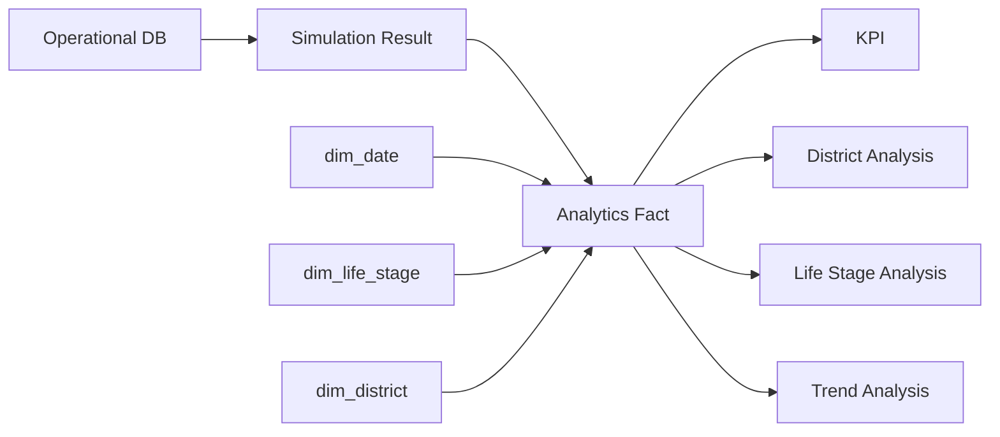

# Pivot Seoul — Housing Affordability Analytics

> **서울 주거비 부담 시뮬레이션 결과를 자치구·생애주기·시간 기준으로 분석하고, RIR과 Red Zone을 통해 주거비 위험 패턴을 비교할 수 있도록 구성한 Data Analytics 프로젝트**

## 1. Project Overview

Pivot Seoul은 사용자의 소득과 주거비 조건을 기반으로 **주거비 부담률(RIR, Rent-to-Income Ratio)**을 계산하고 위험 수준을 판단하는 시뮬레이션 서비스입니다.

Data Analytics 영역에서는 개별 사용자의 결과를 보여주는 데서 끝내지 않고, 누적된 시뮬레이션 결과를 분석 가능한 데이터 구조로 변환해 다음 질문에 답할 수 있도록 구성했습니다.

```text
사용자 조건
   ↓
주거비 시뮬레이션
   ↓
RIR / Risk / Red Zone
   ↓
Analytics Fact
   ↓
지역 / 생애주기 / 날짜 Segment
   ↓
KPI
   ↓
주거비 부담 패턴 분석
```

### 핵심 구현

* 서울 **25개 자치구 Dimension**
* 청년기 / 신혼·출산기 / 노년기 **3개 Life Stage**
* Simulation 결과 중심 **Star Schema**
* `fact_simulation_run`
* 자치구별 RIR Materialized View
* Watermark 기반 증분 Mart 갱신
* SQL Data Quality Check
* Airflow 분석 Pipeline
* 선택적 PySpark Fact Refresh
* Pipeline Run Log / Freshness 관리

---

# 2. Business Problem

같은 월 주거비라도 소득이나 거주 지역, 생애주기에 따라 사용자가 체감하는 부담은 다를 수 있습니다.

따라서 단순히

> "월세가 얼마인가?"

만 보는 것보다

> **"소득 대비 주거비 부담은 어느 정도인가?"**

를 분석하는 것이 필요합니다.

Pivot Seoul은 이를 RIR로 구조화합니다.

```text
RIR
=
Monthly Housing Cost
/
Monthly Income
```

그리고 개별 시뮬레이션 결과를 누적해 다음과 같은 분석이 가능하도록 설계했습니다.

* 어느 지역에서 높은 RIR이 많이 나타나는가?
* Red Zone 비율은 지역별로 어떻게 다른가?
* 생애주기별 주거비 부담 패턴은 다른가?
* 시뮬레이션 결과는 시간에 따라 어떻게 변화하는가?
* RIR과 Risk Score는 어떤 관계를 보이는가?

---

# 3. Analysis Questions

## BQ-01. 어느 자치구에서 주거비 부담이 높게 나타나는가?

지역별로 다음 지표를 비교합니다.

```text
District
   ↓
Simulation Count
Average RIR
Red Zone Count
Red Zone Rate
```

이를 통해 특정 자치구의 시뮬레이션 결과에서 상대적으로 높은 주거비 부담이 관찰되는지 확인합니다.

---

## BQ-02. Red Zone은 어느 지역에 많이 나타나는가?

Pivot Seoul에서는 RIR이 기준을 초과하면 `is_red_zone`으로 관리합니다.

분석 지표:

```text
Red Zone Rate
=
Red Zone Runs
/
Completed Simulation Runs
```

단순 Red Zone 건수만 비교하면 사용자가 많은 자치구가 높게 나타날 수 있으므로, **건수와 비율을 함께 확인하는 것**을 기준으로 합니다.

---

## BQ-03. 생애주기마다 주거비 부담 패턴이 다른가?

분석 Segment:

```text
YOUTH
청년기

FAMILY
신혼·출산기

SENIOR
노년기
```

각 Segment에서 다음을 비교할 수 있습니다.

* Simulation Count
* Average RIR
* Average Risk Score
* Red Zone Rate
* 지역별 분포

이를 통해 생애주기와 지역을 함께 고려한 주거 부담 패턴을 분석할 수 있습니다.

---

## BQ-04. RIR과 Risk Score는 어떤 관계를 보이는가?

`fact_simulation_run`에는 다음 두 값이 함께 존재합니다.

```text
rir_value
risk_score
```

따라서 RIR 증가에 따라 Risk Score가 어떤 패턴을 보이는지 분석할 수 있습니다.

단, 두 변수의 관계가 관찰된다고 해서 **RIR이 모든 위험을 직접 발생시킨다는 인과관계로 확대 해석하지 않습니다.**

---

## BQ-05. 주거비 부담 수준은 시간에 따라 변화하는가?

`run_date_id`와 `dim_date`를 이용해 다음과 같은 추세 분석이 가능합니다.

```text
Day
 ↓
Month
 ↓
Quarter
 ↓
Average RIR
Red Zone Rate
Simulation Count
```

운영 데이터가 충분히 누적되면 월별·분기별 주거비 위험 변화 분석으로 확장할 수 있습니다.

---

# 4. Core Metrics

| KPI                         | 정의                         |
| --------------------------- | -------------------------- |
| Simulation Count            | 완료된 시뮬레이션 실행 수             |
| Average RIR                 | 시뮬레이션 결과의 평균 RIR           |
| Red Zone Count              | `is_red_zone = true`인 결과 수 |
| Red Zone Rate               | Red Zone / Completed Runs  |
| Average Risk Score          | 평균 Risk Score              |
| District Simulation Share   | 특정 자치구 Run / 전체 Run        |
| Life Stage Simulation Share | 특정 생애주기 Run / 전체 Run       |
| Data Freshness              | 분석 Mart의 마지막 갱신 시점         |

현재 Materialized View에는 특히 다음 지표가 구현되어 있습니다.

```text
current_district
run_count
avg_rir
red_zone_count
last_refreshed_at
```

---

# 5. Analytics Data Model

운영 테이블을 매번 직접 Join하는 대신 분석용 `analytics` Schema를 구성했습니다.



---

# 6. Fact Table

## `analytics.fact_simulation_run`

Grain:

> **완료된 Simulation Run 1건**

주요 컬럼:

```text
simulation_run_id
session_id
scenario_result_id

life_stage_id
life_stage_code

current_district

run_date_id

rir_value
is_red_zone
risk_score

run_status
refreshed_at
```

이 테이블 하나에서:

```text
누가 어떤 지역 조건으로
→ 언제 시뮬레이션을 실행했고
→ RIR은 얼마였고
→ Red Zone인지
→ Risk Score는 얼마인지
```

를 분석할 수 있도록 구성했습니다.

---

# 7. Dimensions

## `dim_date`

```text
date_id
full_date
year
quarter
month
day
```

기간별 분석에 사용합니다.

---

## `dim_life_stage`

```text
YOUTH
FAMILY
SENIOR
```

생애주기 Segment 분석에 사용합니다.

---

## `dim_district`

서울 25개 자치구를 다음 권역과 함께 관리합니다.

```text
도심권
동북권
서북권
서남권
동남권
```

따라서 추후:

```text
자치구
   ↓
권역
   ↓
서울 전체
```

단계로 분석 범위를 확장할 수 있습니다.

---

# 8. District RIR Mart

자주 조회하는 지역별 RIR 집계를 매번 원본 Fact에서 계산하지 않고 Materialized View로 구성했습니다.

```text
analytics.mv_district_rir_summary
```

저장되는 지표:

| Field               | 의미            |
| ------------------- | ------------- |
| `current_district`  | 현재 거주 자치구     |
| `run_count`         | 완료 시뮬레이션 수    |
| `avg_rir`           | 평균 RIR        |
| `red_zone_count`    | Red Zone 결과 수 |
| `last_refreshed_at` | Mart 갱신 시점    |

분석 흐름:

```text
fact_simulation_run
        ↓
GROUP BY district
        ↓
Average RIR
Red Zone Count
Simulation Count
        ↓
mv_district_rir_summary
```

---

# 9. Incremental Analytics

전체 Simulation History를 매번 다시 계산하지 않고 `updated_at` 기준 Watermark 이후 변경된 데이터만 처리하도록 구성했습니다.

```text
etl_watermark
      ↓
last source timestamp
      ↓
changed simulation runs
      ↓
UPSERT
      ↓
fact_simulation_run
      ↓
Materialized View Refresh
```

관리 Metadata:

```text
job_name
last_success_at
last_row_count
source_max_ts
```

이를 통해 분석 데이터가 **언제까지 반영되었는지** 확인할 수 있습니다.

---

# 10. Data Quality

분석 전에 데이터가 신뢰 가능한 상태인지 SQL 검증을 수행합니다.

현재 검증 항목은 다음과 같습니다.

### DBQC-001

Life Stage 기준정보:

```text
3개 존재
stage_code UNIQUE
NULL 없음
```

### DBQC-002

`HOUSING` Threshold 존재 여부

### DBQC-003

`user_condition → simulation_session`

FK Orphan 확인

### DBQC-004

`scenario_result → simulation_run`

FK 무결성 확인

### DBQC-005

Threshold Status와 RIR 값 검증

허용 상태:

```text
STABLE
WARNING
DANGER
UNKNOWN
```

또한 Red Zone 데이터가 정의된 RIR 조건과 일치하는지 검사합니다.

### DBQC-006

Demo Dataset Row Count 검증

### DBQC-007

운영 Simulation Run과 Analytics Fact 간 Freshness 확인

---

# 11. Reproducible Demo Dataset

실제 사용자 결과를 성과처럼 사용하는 대신, Repository에 재현 가능한 Demo Dataset을 포함했습니다.

현재 Demo는 청년기(`YOUTH`) / 마포구 조건으로 구성되어 있습니다.

| Scenario | Monthly Income |   Housing |  RIR | Status  | Red Zone |
| -------- | -------------: | --------: | ---: | ------- | -------- |
| Stable   |      5,000,000 | 1,500,000 | 0.30 | STABLE  | No       |
| Warning  |      5,000,000 | 2,000,000 | 0.40 | WARNING | No       |
| Danger   |      5,000,000 | 2,250,000 | 0.45 | DANGER  | Yes      |

별도로 실제 Run API 검증을 위한 `READY` Session도 존재합니다.

이 데이터는 **실제 서울시민의 주거비 통계가 아니라 분석·QA 재현을 위한 Demo 데이터**입니다.

---

# 12. Demo Interpretation

Demo 데이터에서는 동일한 월 소득 500만 원 조건에서 주거비가 증가하면서 다음과 같은 RIR 변화가 발생하도록 구성되어 있습니다.

```text
주거비 150만
→ RIR 0.30
→ STABLE

주거비 200만
→ RIR 0.40
→ WARNING

주거비 225만
→ RIR 0.45
→ DANGER / RED ZONE
```

따라서 테스트 데이터를 통해:

> **월소득이 동일할 때 주거비가 증가하면서 RIR과 Risk 상태가 어떤 방식으로 달라지는지**

분석 로직을 재현할 수 있습니다.

다만 이것은 **Demo 시나리오의 동작 확인 결과이며 실제 서울 지역의 통계적 인사이트가 아닙니다.**

---

# 13. Analysis Pipeline

분석 데이터 준비 과정은 Airflow DAG로 연결했습니다.

```text
Reference Data Load
        ↓
Demo / Source Load
        ↓
Analytics Mart Refresh
        ↓
Data Quality Check
        ↓
Query Plan Check
```

DAG:

```text
pivot_mvp_pipeline
```

Schedule:

```text
@daily
```

Retry:

```text
1회
5분 간격
```

분석 데이터 생성과 품질 검증 순서를 고정해 동일한 분석 환경을 다시 만들 수 있도록 구성했습니다.

---

# 14. Pipeline Observability

분석 결과뿐 아니라 분석 Pipeline 자체의 상태도 저장합니다.

```text
analytics.pipeline_run_log
```

주요 항목:

```text
job_name
started_at
completed_at
status

processed_row_count
failed_row_count

query_runtime_ms

source_max_ts
target_max_ts

error_message
```

이를 통해:

* Pipeline 성공 여부
* 처리 데이터 수
* 실패 데이터 수
* 실행 시간
* 데이터 Freshness
* 실패 원인

을 추적할 수 있습니다.

---

# 15. Optional Spark Processing

데이터 규모가 커졌을 때를 고려해 PySpark 기반 Fact Refresh 경로도 구성했습니다.

```text
PostgreSQL
    ↓
Spark JDBC
    ↓
Completed Simulation
    ↓
Watermark Filter
    ↓
Join
    ↓
Dedup
    ↓
fact_simulation_run
```

Spark에서는 다음 Source를 결합합니다.

```text
simulation_run
simulation_session
life_stage
user_condition
scenario_result
threshold_result
```

현재 MVP 분석은 PostgreSQL SQL 기반 경로만으로도 실행 가능하며, Spark는 데이터 규모 확장 시 사용할 수 있는 선택적 처리 경로입니다.

---

# 16. Analytics Queries

## 지역별 평균 RIR

```sql
SELECT
    current_district,
    run_count,
    avg_rir
FROM analytics.mv_district_rir_summary
ORDER BY avg_rir DESC;
```

---

## 지역별 Red Zone 비율

```sql
SELECT
    current_district,
    run_count,
    red_zone_count,
    red_zone_count::NUMERIC
        / NULLIF(run_count, 0) AS red_zone_rate
FROM analytics.mv_district_rir_summary
ORDER BY red_zone_rate DESC;
```

---

## 생애주기별 RIR

```sql
SELECT
    life_stage_code,
    COUNT(*) AS run_count,
    AVG(rir_value) AS avg_rir,
    AVG(risk_score) AS avg_risk_score
FROM analytics.fact_simulation_run
GROUP BY life_stage_code
ORDER BY avg_rir DESC;
```

---

## 월별 RIR 추이

```sql
SELECT
    d.year,
    d.month,
    COUNT(*) AS run_count,
    AVG(f.rir_value) AS avg_rir
FROM analytics.fact_simulation_run f
JOIN analytics.dim_date d
    ON d.date_id = f.run_date_id
GROUP BY d.year, d.month
ORDER BY d.year, d.month;
```

---

# 17. DA Interpretation Principles

Pivot Seoul DA에서는 분석 결과를 다음 원칙으로 해석합니다.

### 1. Simulation과 실제 서울 통계를 구분

사용자 시뮬레이션 결과는 실제 서울 전체 인구를 대표하는 표본이 아닙니다.

따라서:

> "강남구 주민의 RIR이 높다"

처럼 확대 해석하지 않고,

> "Pivot Seoul 시뮬레이션 데이터에서 강남구 조건의 평균 RIR이 상대적으로 높게 관찰되었다"

처럼 분석 범위를 명확하게 표현합니다.

### 2. Count와 Rate를 함께 확인

사용자가 많은 지역은 Red Zone 건수도 자연스럽게 많아질 수 있으므로:

```text
Red Zone Count
+
Red Zone Rate
```

를 함께 확인합니다.

### 3. Correlation과 Causation을 구분

RIR과 Risk Score 또는 지역과 위험 수준 사이에 관계가 보여도 인과관계로 단정하지 않습니다.

---

# 18. Tech Stack

| Category               | Stack                         |
| ---------------------- | ----------------------------- |
| Database               | PostgreSQL                    |
| Analysis               | SQL                           |
| Data Modeling          | Star Schema                   |
| Aggregation            | Materialized View             |
| Pipeline               | Apache Airflow                |
| Distributed Processing | PySpark                       |
| Migration              | Flyway                        |
| Data Quality           | SQL DBQC                      |
| Monitoring             | Pipeline Run Log / Micrometer |
| Environment            | Docker Compose                |

---

# 19. Repository Structure

```text
da/
├── docs/
│   └── DATA-EFFICIENCY-MVP.md
│
├── sql/
│   └── 06_refresh_analytics_mart.sql
│
├── airflow/
│   └── dags/
│       └── pivot_mvp_pipeline.py
│
├── spark/
│   └── refresh_fact.py
│
└── README.md
```

관련 DB 자산:

```text
back/db/
├── migration/
│   └── V8__data_efficiency_mvp.sql
│
├── data/
│   ├── 01_reference.sql
│   ├── 02_districts.sql
│   └── 03_demo_mvp.sql
│
├── quality/
│   └── run_checks.sql
│
└── load.sh
```

---

# 20. How to Run

## DB / Backend 실행

```bash
docker compose up -d db back
```

## 전체 데이터 준비

```bash
./back/db/load.sh
```

## Analytics Mart 증분 갱신

```bash
./back/db/load.sh --incremental
```

또는:

```bash
psql "$DATABASE_URL" \
    -f da/sql/06_refresh_analytics_mart.sql
```

## Data Quality

```bash
./back/db/load.sh --quality
```

## 핵심 Query 실행계획

```bash
./back/db/load.sh --explain
```

---

# 21. Current Evidence

| Area                           | Status          |
| ------------------------------ | --------------- |
| 서울 25개 자치구 Master              | Implemented     |
| 3개 Life Stage                  | Implemented     |
| RIR / Red Zone Result          | Implemented     |
| Analytics Star Schema          | Implemented     |
| `fact_simulation_run`          | Implemented     |
| District RIR Materialized View | Implemented     |
| Incremental Mart Refresh       | Implemented     |
| Data Quality SQL               | Implemented     |
| Pipeline Run Log               | Implemented     |
| Airflow DAG                    | Implemented     |
| PySpark Refresh Path           | Implemented     |
| Demo Dataset                   | Implemented     |
| Production User Analysis       | Not Verified    |
| BI Dashboard                   | Not Implemented |
| 실제 서울시민 대표 통계 분석               | Not Claimed     |

---

# 22. What I Focused On

Pivot Seoul의 DA 영역에서는 단순히 SQL을 작성하는 데 그치지 않고,

```text
Business Question
       ↓
Metric Definition
       ↓
Analysis Grain
       ↓
Star Schema
       ↓
Data Quality
       ↓
Segment Analysis
       ↓
Interpretation
       ↓
Decision Support
```

흐름을 만드는 데 집중했습니다.

특히 운영 시뮬레이션 테이블을 그대로 분석하는 대신 `fact_simulation_run`을 중심으로 **날짜·생애주기·지역 Dimension을 분리**해 같은 KPI를 반복해서 재현할 수 있도록 설계했습니다.

또한 실제 분석 결과를 신뢰하기 위해 계산 결과뿐 아니라 Watermark, Data Quality, Pipeline Run Log를 함께 관리하도록 구성했습니다.

---

# 23. Next Steps

현재 분석 Mart를 기반으로 다음 단계로 확장할 수 있습니다.

```text
Simulation Data
       ↓
Analytics Mart
       ↓
SQL KPI
       ↓
Python EDA
       ↓
District / Life-stage Analysis
       ↓
Visualization
       ↓
Dashboard
```

확장 후보:

* 자치구별 RIR 분포
* 권역별 주거비 부담 비교
* 생애주기 × 자치구 Heatmap
* 월별 RIR Trend
* Red Zone Rate Dashboard
* RIR / Risk Score 분포 분석
* 사용자 조건 Segment 분석
* 실제 공공 주거·소득 데이터와의 비교 분석
* Tableau / Power BI Dashboard

---

# Summary

**Pivot Seoul DA는 개별 주거비 시뮬레이션 결과를 `지역 × 생애주기 × 시간` 기준의 분석 데이터로 변환하고, RIR·Risk Score·Red Zone을 통해 주거비 부담 패턴을 비교할 수 있도록 Star Schema와 Analytics Mart를 구축한 프로젝트입니다.**

운영 데이터와 분석 데이터를 분리하고, 증분 갱신·Data Quality·Pipeline Log까지 연결해 동일한 기준으로 KPI를 반복 계산할 수 있는 분석 기반을 구성했습니다.

현재 실제 구현된 범위와 Demo 데이터를 기준으로 작성했으며, 실제 서울시민을 대표하는 통계나 구현되지 않은 BI Dashboard 성과는 포함하지 않습니다.
